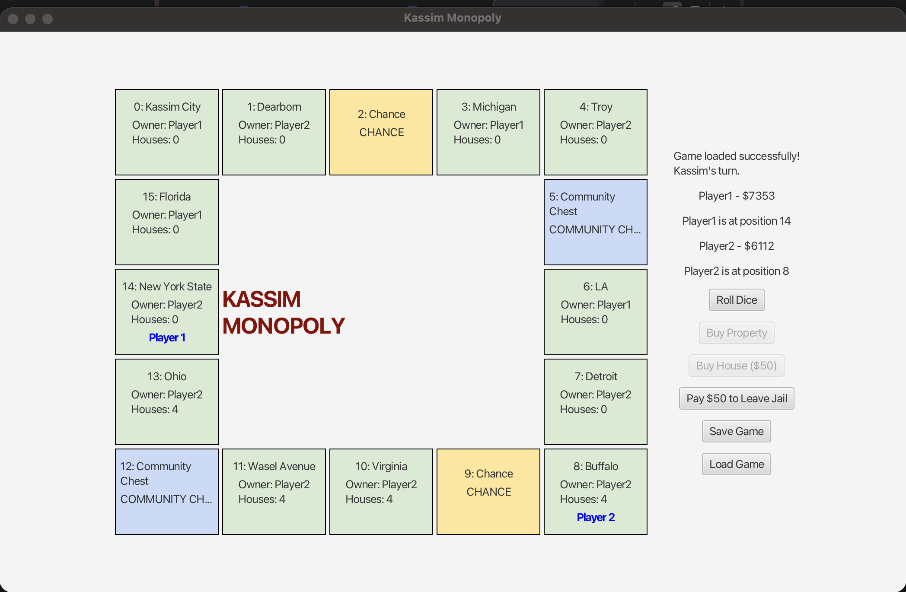
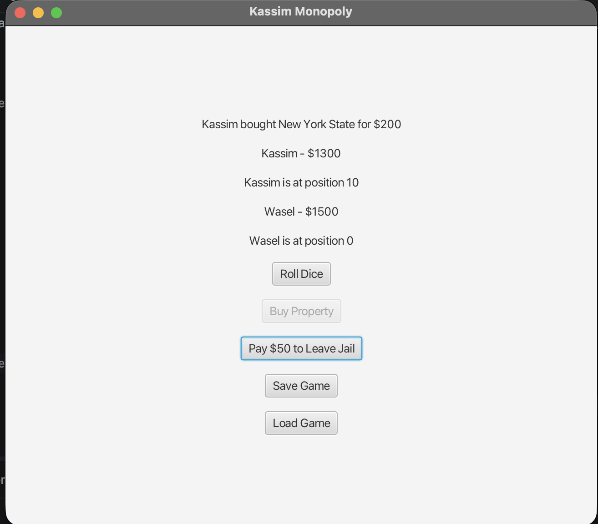

Kassim Monopoly — JavaFX GUI

A two-player Monopoly game developed in Java using JavaFX for the graphical user interface.

Features

* Two players: Kassim and Wasel
* Roll two dice and move around a 12-property board
* Alternate turns between players
* Buy available properties
* Pay rent when landing on another player’s property
* Collect $200 when passing GO
* Roll doubles to receive an extra turn
* Go to jail after rolling three consecutive doubles
* Pay $50 to leave jail
* Save and load game progress, including player money, positions, property ownership, and turns

Technologies

* Java
* JavaFX
* Maven
* IntelliJ IDEA

How to Run

1. Open Project_3_Monopoly_GUI in IntelliJ IDEA.
2. Open the Maven panel.
3. Run Lifecycle → compile.
4. Run Plugins → javafx → javafx:run.
5. The Monopoly GUI window will open.

How to Play

1. Click Roll Dice to move a player.
2. Click Buy Property to purchase an available property.
3. Pay rent automatically when landing on another player’s property.
4. Collect $200 when passing GO.
5. Roll doubles for another turn. Three consecutive doubles send the player to jail.
6. Use Pay $50 to Leave Jail when necessary.
7. Click Save Game to save progress.
8. Click Load Game to restore a saved game.

Screenshots

Screenshots of the JavaFX game interface will be added before submission.

Author
Kassim Wasel

