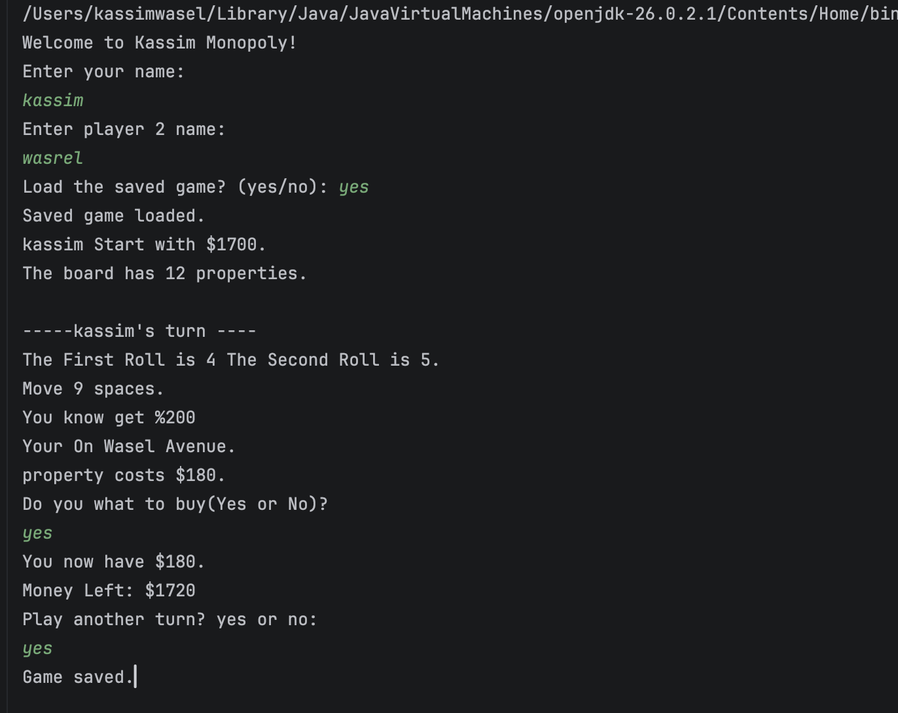
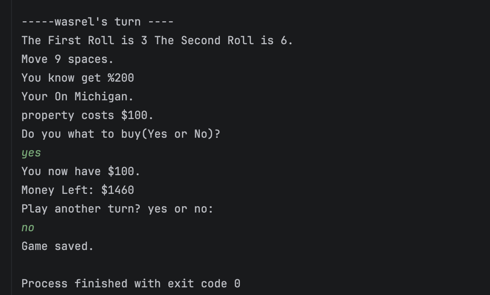

# Kassim Monopoly

A simple two-player Monopoly game written in Java.

## Features

- Two players take turns rolling two dice
- Players can buy properties
- Players pay rent when landing on another player’s property
- Doubles give an extra turn
- Three doubles sends a player to jail
- Players pay $50 to leave jail
- Passing Go gives $200
- A player who runs out of money loses their properties
- The game saves automatically and can load a previous game

## How to Run

Run `Main.java` in IntelliJ IDEA.
## Game Screenshot

